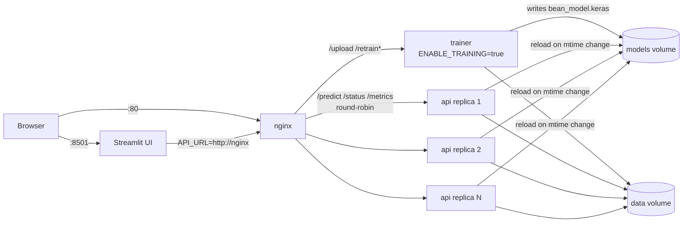
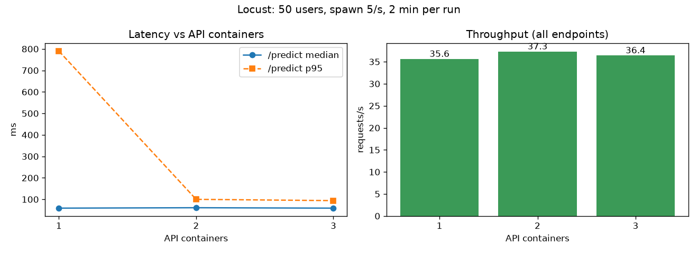

# Bean Leaf Disease ML Pipeline

An end-to-end machine learning pipeline that diagnoses **bean leaf diseases from smartphone photos**. It covers data
acquisition, model training and evaluation, a REST API, a web UI, bulk data upload with one-click retraining, Docker
deployment behind a load balancer, and load testing with Locust.

| | |
|---|---|
| **Demo video** | _YouTube link: add after recording_ |
| **Live UI** | _http://&lt;VM-IP&gt;:8501: add after deployment_ |
| **Live API docs** | _http://&lt;VM-IP&gt;/docs: add after deployment_ |

## Problem and data

Angular leaf spot and bean rust are two of the most damaging diseases of common beans, a staple crop across East
Africa. Early diagnosis from a phone photo lets farmers act before the disease spreads.

* **Dataset:** [Beans](https://huggingface.co/datasets/AI-Lab-Makerere/beans) by the Makerere AI Lab (Uganda): field photos
  in three classes: `angular_leaf_spot`, `bean_rust`, `healthy`.
* 1,167 training images (HF train + validation, balanced at about 390 per class) and 128 held-out test images.

## Model and results

MobileNetV2 (ImageNet) transfer learning, trained in two stages: a frozen-backbone head, then fine-tuning of the top
54 backbone layers. Training uses augmentation (flip, rotation, zoom, contrast), dropout, early stopping and class weights.
Saved as `models/bean_model.h5` (and `bean_model.keras`), about 9 MB.

**Held-out test set (128 images):**

| Accuracy | Precision (macro) | Recall (macro) | F1 (macro) | ROC-AUC (OvR macro) |
|---:|---:|---:|---:|---:|
| **0.914** | 0.915 | 0.915 | 0.913 | 0.989 |

| Class | Precision | Recall | F1 |
|---|---:|---:|---:|
| angular_leaf_spot | 0.891 | 0.953 | 0.921 |
| bean_rust | 0.921 | 0.814 | 0.864 |
| healthy | 0.932 | 0.976 | 0.953 |

The weakest class is early-stage **bean rust**: a few tiny pustules on an otherwise green leaf. Most of these errors
have low confidence. Full EDA (three feature interpretations), confusion matrices, ROC curves and an error analysis are
in [`notebook/bean_disease.ipynb`](notebook/bean_disease.ipynb).

## Features

* **Single-image prediction**: upload a leaf photo and get the class, confidence and per-class probabilities.
* **Visualizations**: live class distribution, leaf colour (RGB and hue) per class, and brightness/contrast (lighting-bias
  check), each with an interpretation.
* **Bulk upload**: upload many labelled images at once; they are validated (type, 5 MB limit, decodable) and queued
  in `data/uploads/<class>/`.
* **Retraining**: a *Retrain model* button (or `POST /retrain`) fine-tunes the current model on the training set plus
  uploads in a background thread, with live epoch progress and before/after metrics. Retraining also **triggers automatically**
  once pending uploads reach `RETRAIN_THRESHOLD` (default 30). Only one retrain can run at a time (409 otherwise).
  Every retrain backs up the previous model and bumps the model version.
* **Monitoring**: uptime, model version, last training time, prediction/request counters and a health indicator.
* **Scalable serving**: nginx round-robins prediction traffic across N API containers; retrained models are
  hot-reloaded by every replica.

## Architecture



**Retraining with several replicas.** A dedicated `trainer` service owns `/upload` and `/retrain`. The scalable `api`
service runs with `ENABLE_TRAINING=false` and only serves predictions. A dedicated service was chosen over a
"designated replica" because `docker compose --scale` gives every replica identical environment variables. The trainer
writes the new model atomically to the shared `models` volume, and each API replica reloads it on its next request
(an mtime check in `src/prediction.py`). Named volumes mean retrained models and uploaded data survive container restarts.

## API

| Endpoint | Description |
|---|---|
| `GET /status` | start time, uptime, model version, trained_at, pending uploads, counters |
| `POST /predict` | multipart `file` → `{label, confidence, probabilities}`; 400 for non-images |
| `POST /upload` | multipart `files` (many) + form `label` → saved/rejected counts, pending count |
| `POST /retrain?epochs=N` | starts a background retrain → `{job_id}`; 409 if one is running |
| `GET /retrain/status` | `idle` / `running` (with epoch progress) / `done` / `failed`, plus metrics |
| `GET /metrics` | latest test metrics, training class distribution, prediction counter |

Interactive docs: `http://localhost/docs` (Docker) or `http://localhost:8000/docs` (local).

## Setup

### Local (Python 3.11)

```bash
uv venv --python 3.11 .venv            # or: py -3.11 -m venv .venv
# Windows: .venv\Scripts\activate   |   Linux/macOS: source .venv/bin/activate
pip install -r requirements.txt

python -m src.data_acquisition         # downloads the dataset to data/train and data/test
python -m src.model                    # optional: retrain from scratch (~10 min on CPU)
python -m src.preprocessing            # optional: regenerate docs/eda_stats.json

uvicorn api.main:app --port 8000       # API
streamlit run ui/app.py                # UI (API_URL defaults to http://localhost:8000)
pytest                                 # API tests
```

To run the notebook with the venv's kernel:
`python -m ipykernel install --sys-prefix --name bean-ml`, then pick **Python 3.11 (bean-ml)** in Jupyter.

### Docker

```bash
docker compose up -d --build --scale api=2
# UI:  http://localhost:8501     API (via nginx): http://localhost/docs
```

On first start the trainer downloads the dataset into the `data` volume. Environment knobs: `RETRAIN_THRESHOLD`,
`RETRAIN_EPOCHS`, `API_CPUS` (CPU limit per API replica, default 1).

### Cloud (Ubuntu VM, 2 vCPU / 4 GB RAM or more)

```bash
curl -fsSL https://raw.githubusercontent.com/dusengepeggy/MLOP-SUMMATIVE/main/deploy/setup_vm.sh | bash
```

The script installs Docker, adds swap, clones the repo and starts the stack with two API replicas. Open inbound TCP
**80** and **8501** in the cloud firewall / security group. Free tiers with 512 MB RAM (for example Render) are too small
for TensorFlow.

## Load testing (Locust)

`locustfile.py` simulates users who call `/predict` (weight 5, real leaf images), `/status` (2) and `/metrics` (1),
waiting 0.5–2 s between requests. The same profile (50 users, spawn rate 5/s, 2 minutes, headless) was run against
1, 2 and 3 API containers, each limited to 1 CPU:

```bash
bash scripts/run_load_tests.sh            # writes docs/locust_api{1,2,3}.html and CSVs
python scripts/summarize_locust.py        # prints the table, draws docs/locust_scaling.png
```

| API containers | Median (ms) | p95 (ms) | Requests/s | Failures % | `/predict` median (ms) |
|---:|---:|---:|---:|---:|---:|
| 1 | 1800 | 6100 | 15.3 | 0.00 | 2400 |
| 2 | 170 | 1700 | 28.5 | 0.00 | 600 |
| 3 | 120 | 1500 | 30.9 | 0.00 | 250 |



A single 1-CPU container saturates at about 10 predictions/s, so requests queue. A second container nearly doubles
throughput and cuts the median latency 10x. The third container adds only 8 % more throughput because the test's 50 users
can generate at most about 32 req/s, so the load generator, not the servers, becomes the limit. Full details,
per-endpoint numbers and HTML reports are in [`docs/locust_results.md`](docs/locust_results.md).

## Repository layout

```
├── README.md
├── notebook/bean_disease.ipynb     # EDA, training, evaluation, prediction demo
├── src/
│   ├── config.py                   # paths and constants (env-overridable)
│   ├── data_acquisition.py         # download the Beans dataset
│   ├── preprocessing.py            # image loading, tf.data, augmentation, uploads, EDA features
│   ├── model.py                    # build / train / evaluate / save / retrain
│   └── prediction.py               # cached, hot-reloading inference
├── data/{train,test,uploads}/      # populated by data_acquisition / uploads (git-ignored)
├── models/                         # bean_model.h5, bean_model.keras, bean_model_meta.json
├── api/main.py                     # FastAPI service
├── ui/app.py                       # Streamlit UI
├── tests/                          # pytest + TestClient
├── locustfile.py
├── Dockerfile.api, Dockerfile.ui, docker-compose.yml, nginx.conf
├── deploy/setup_vm.sh              # cloud VM bootstrap
├── scripts/                        # load-test runner, results summary, submission zip
├── docs/                           # Locust reports, scaling chart, EDA stats, sample images
└── requirements.txt                # (requirements-api.txt: slim container deps)
```
