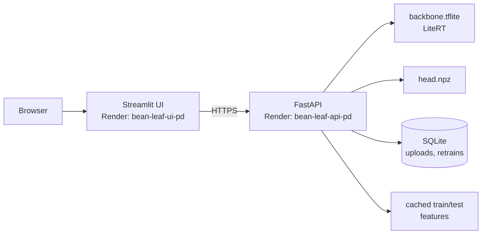

# Bean Leaf Disease ML Pipeline

An end-to-end machine learning pipeline that diagnoses **bean leaf diseases from smartphone photos**. It covers:
- data acquisition, preprocessing, MobileNetV2 transfer learning and evaluation
- a FastAPI service and a Streamlit UI for prediction, data upload (saved to a database) and retraining
- Docker deployment behind an nginx load balancer
- a live cloud deployment
- load testing with Locust

| | |
|---|---|
| **Live app (UI)** | https://bean-leaf-ui-pd.onrender.com |
| **Live API (Swagger docs)** | https://bean-leaf-api-pd.onrender.com/docs |
| **Demo video** | https://youtu.be/3_1zHjm-mMQ|

> Free hosting note: Render's free instances sleep after 15 minutes without traffic. The first request after that
> takes about 20 s (cold start), and a restart resets uploads and retrained models to the deployed baseline. The
> services are kept awake with an uptime pinger (UptimeRobot, every 5 minutes).

## Problem and data

Angular leaf spot and bean rust are two of the most damaging diseases of common beans, a staple crop across East Africa.
Diagnosing them early from a phone photo lets farmers act before the disease spreads.

- **Source:** [Beans](https://huggingface.co/datasets/AI-Lab-Makerere/beans) (Makerere AI Lab, Uganda), downloaded by
  `src/data_acquisition.py`. These are field photos in 3 classes: `angular_leaf_spot`, `bean_rust` and `healthy`.
- **Explicit splits in the repo:**
  - `data/train/<class>/`: 1,167 images (HF train + validation, about 390 per class). A 15 % validation split is carved
    out at training time.
  - `data/test/<class>/`: 128 held-out test images, used only for evaluation.
  - The committed images are resized to 256 px (the model uses 224 px). `python -m src.data_acquisition --force`
    restores the full-size originals.

## Model and evaluation

- **Architecture:** MobileNetV2 (ImageNet weights) → global average pooling → dropout 0.3 → dense softmax(3).
- **Optimisation:**
  - transfer learning with two-stage training: a frozen-backbone head, then fine-tuning of the top 54 backbone layers at a 100x lower learning rate
  - Adam
  - data augmentation (flip, rotation, zoom, contrast)
  - dropout
  - early stopping
  - inverse-frequency class weights
- **Model files:** `models/bean_model.h5` and `models/bean_model.keras`.

Held-out test set (128 images, full-resolution evaluation in the notebook):

| Accuracy | Precision (macro) | Recall (macro) | F1 (macro) | ROC-AUC |
|---:|---:|---:|---:|---:|
| **0.914** | 0.915 | 0.915 | 0.913 | 0.989 |

What the numbers mean in practice:
- **Accuracy 0.914:** 117 of 128 field photos are diagnosed correctly.
- **Precision 0.915:** when the app reports a disease, it is right about 92 % of the time, so farmers rarely spray a
  healthy crop.
- **Recall:** this matters most here, because a missed disease is the costly error. Recall is 0.98 for healthy leaves,
  0.95 for angular leaf spot and **0.81 for bean rust**. Early rust (a few tiny pustules) is the weak spot: only 3 of the
  86 diseased test leaves were called "healthy", all of them rust.
- **ROC-AUC 0.989:** the probabilities rank correctly even when the top choice is wrong, so a confidence threshold can
  route uncertain photos to a human.

The served model (below) scores **accuracy 0.930, F1 0.929, loss 0.179** on the same test set, because the
committed 256 px copies are slightly different inputs. Full EDA, metric interpretation, confusion matrices, ROC curves
and an error analysis are in [`notebook/bean_disease.ipynb`](notebook/bean_disease.ipynb).

### Data insights and how they shaped the pipeline

| Feature (visualised in the notebook and the UI) | Finding | Decision |
|---|---|---|
| Class distribution | Balanced (max/min = 1.02) | Accuracy is meaningful, but macro precision, recall and F1 are reported too. Class weights are applied at every retrain because uploads can unbalance the data |
| Leaf colour (mean R/G/B, hue) | Healthy leaves are greener (hue 99° vs 75–78°), but distributions overlap | Use a CNN on pixels (texture and lesions), not colour features. Fine-tune the backbone |
| Brightness and contrast | No lighting bias (contrast p = 0.22); rust is slightly darker because of its pustules | No lighting normalisation needed. Contrast augmentation for robustness |

## Prediction, upload and retraining (the deployed pipeline)

To run on a free 512 MB host, the API serves the trained model **without TensorFlow**.
`scripts/export_serving_model.py` splits `bean_model.h5` into:
- `models/backbone.tflite`: rescaling + fine-tuned MobileNetV2 + pooling, run with LiteRT
- `models/head.npz`: the trained softmax layer

Predictions match the Keras model to 5×10⁻⁶, with identical labels on all 128 test images. Each API process uses about
70 MB of RAM.

1. **Predict:** upload a leaf photo (or pick a held-out test image). The image is resized to 224×224, passed through
   the backbone and the head, and the app returns the class, confidence and all class probabilities.
2. **Upload training data:** upload many labelled images at once. Each file is validated (type, 5 MB limit, decodable),
   **saved to `data/uploads/` and recorded in the SQLite database** (`data/bean.db`, table `uploads`).
3. **Preprocessing of uploads:** each upload is converted to RGB, resized to 224×224 and turned into a feature vector by
   the trained backbone. The vector is stored in the database, and the row's status moves `pending → preprocessed`.
4. **Retrain:** the *Retrain model* button (or `POST /retrain`, or automatically once 30 uploads are pending) fine-tunes
   **our trained model's classifier head, starting from its current weights**, on the original training features plus
   all uploads:
   - Adam (lr 3e-4), L2 regularisation and class weights
   - early stopping on a validation split
   - the previous version is backed up, and every replica hot-reloads the new one
5. **Evaluate:** the **held-out test set** is scored before and after each retrain. The UI shows accuracy, precision,
   recall, F1, ROC-AUC and loss with their change, and the run is recorded in the `retrains` table.

Full end-to-end fine-tuning (backbone included) remains available offline: `python -m src.model`.

## API

| Endpoint | Description |
|---|---|
| `GET /status` | start time, uptime, model version, pending uploads, request/prediction counters |
| `POST /predict` | multipart `file` → `{label, confidence, probabilities}`; 400 for non-images |
| `POST /upload` | multipart `files` (many) + form `label` → saved to DB and preprocessed; returns IDs and the pending count |
| `GET /uploads` | database records of the uploaded images (status, checksum, size, retrain ID) |
| `POST /retrain?epochs=N` | starts a background retrain → `{job_id}`; 409 if one is already running |
| `GET /retrain/status` | `idle` / `running` (epoch, validation loss) / `done` / `failed`, with before/after metrics |
| `GET /retrain/history` | all retraining runs with test metrics before and after |
| `GET /metrics` | current test metrics (incl. loss), class distribution, prediction counter |

## Architecture



Self-hosted variant (`docker compose`): nginx round-robins `/predict`, `/status` and `/metrics` across N `api` replicas
(prediction only). A single `trainer` service owns `/upload` and `/retrain`. Named volumes share the models and the
database, and replicas reload `head.npz` when it changes.

## Setup

### Local (Python 3.11)

```bash
uv venv --python 3.11 .venv            # or: py -3.11 -m venv .venv
# Windows: .venv\Scripts\activate   |   Linux/macOS: source .venv/bin/activate
pip install -r requirements.txt

uvicorn api.main:app --port 8000       # API (uses the committed serving artifacts)
streamlit run ui/app.py                # UI  (API_URL defaults to http://localhost:8000)
pytest                                 # tests, including a real retrain

# Optional, full pipeline from scratch:
python -m src.data_acquisition --force # full-size dataset
python -m src.model                    # train MobileNetV2 (~10 min on CPU) -> models/bean_model.h5
python scripts/export_serving_model.py # -> backbone.tflite, head.npz, cached features
```

For the notebook, run `python -m ipykernel install --sys-prefix --name bean-ml` and choose the
**Python 3.11 (bean-ml)** kernel.

### Docker

```bash
docker compose up -d --build --scale api=2
# UI: http://localhost:8501     API via nginx: http://localhost/docs
```

### Cloud (Render, free)

`render.yaml` is a Render Blueprint: Render dashboard → **New → Blueprint** → select this repository → **Deploy**.
It creates the API (Docker) and the UI (Python) as free web services. Then add two UptimeRobot HTTP monitors
(every 5 min) for `https://bean-leaf-api-pd.onrender.com/status` and `https://bean-leaf-ui-pd.onrender.com` to keep
them awake. An alternative self-hosted VM setup is in `deploy/setup_vm.sh`.

## Load testing (Locust)

Full results, per-endpoint tables and HTML reports are in [`docs/locust_results.md`](docs/locust_results.md).

**Cloud (Render free, 1 instance, 10 users, 2 min):**

| Requests | Failures | Median | p95 | `/predict` median / p95 | Requests/s | Uptime during test |
|---:|---:|---:|---:|---:|---:|---:|
| 702 | 0 % | 350 ms | 720 ms | 360 / 700 ms | 5.9 | 100 % (no restarts) |

About 260 ms of each response is the network round trip from Kigali to Frankfurt; a prediction adds about 100 ms of
server time. A cold start after the instance sleeps takes about 18 s.

**Scaling (local Docker + nginx, 50 users, 2 min, 1 CPU / 512 MB per container):**

| API containers | Median (ms) | p95 (ms) | Requests/s | Failures % |
|---:|---:|---:|---:|---:|
| 1 | 54 | 370 | 35.6 | 0.00 |
| 2 | 55 | 110 | 37.3 | 0.00 |
| 3 | 51 | 94 | 36.4 | 0.00 |


One container already absorbs the full load; throughput is capped by what 50 users can generate (about 38 req/s).
Extra containers cut the tail latency (p95 370 → 110 ms), and scaling stops paying off after 2 containers.

```bash
bash scripts/run_load_tests.sh            # 1/2/3 containers -> docs/locust_api{1,2,3}.html
python scripts/summarize_locust.py        # table + docs/locust_scaling.png
locust -f locustfile.py --host https://bean-leaf-api-pd.onrender.com --headless -u 10 -r 2 -t 2m
```

## Repository layout

```
├── README.md
├── notebook/bean_disease.ipynb     # EDA, preprocessing, training, evaluation, prediction demo
├── src/
│   ├── data_acquisition.py         # download the Beans dataset
│   ├── preprocessing.py            # image loading, tf.data pipelines, augmentation, uploads, EDA features
│   ├── model.py                    # build / train / evaluate / save MobileNetV2 (TensorFlow)
│   ├── prediction.py               # prediction with the full Keras model (notebook / offline)
│   ├── serving.py                  # TF-free prediction: LiteRT backbone + numpy head
│   ├── retrain_light.py            # upload -> preprocess -> retrain -> evaluate pipeline
│   ├── db.py                       # SQLite: uploads and retraining runs
│   ├── metrics.py, config.py
├── data/train, data/test           # explicit splits (256 px); data/uploads for new data (git-ignored)
├── models/                         # bean_model.h5/.keras, backbone.tflite, head.npz, cached features
├── api/main.py                     # FastAPI service
├── ui/app.py                       # Streamlit UI
├── tests/                          # pytest + TestClient
├── locustfile.py
├── Dockerfile.api, Dockerfile.ui, docker-compose.yml, nginx.conf, render.yaml
├── scripts/                        # export, dataset resize, load tests, summary, submission zip
└── docs/                           # Locust reports and chart, EDA stats, sample images
```
