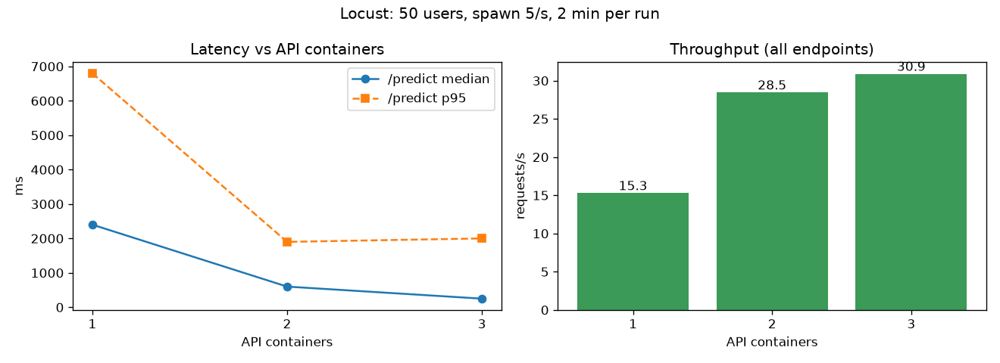

# Locust load-test results

**Profile (identical for every run):** 50 users, spawn rate 5/s, 2 minutes, headless; each user waits 0.5–2 s between
tasks and calls `/predict` (weight 5, real 500x500 leaf photos), `/status` (2) and `/metrics` (1).
**Target:** nginx on `http://localhost`, round-robin to N `api` containers, each limited to **1 CPU** and 1.5 GB RAM
(`INFERENCE_THREADS=1`). **Machine:** Docker Desktop on a 16-core Windows laptop; Locust ran on the same machine.
Reproduce with `bash scripts/run_load_tests.sh`, then `python scripts/summarize_locust.py`.

| Containers | Endpoint | Requests | Median (ms) | p95 (ms) | Avg (ms) | Requests/s | Failures % |
|---:|---|---:|---:|---:|---:|---:|---:|
| 1 | all | 1818 | 1800 | 6100 | 1865 | 15.3 | 0.00 |
| 1 | predict | 1147 | 2400 | 6800 | 2941 | 9.6 | 0.00 |
| 2 | all | 3383 | 170 | 1700 | 456 | 28.5 | 0.00 |
| 2 | predict | 2082 | 600 | 1900 | 735 | 17.5 | 0.00 |
| 3 | all | 3671 | 120 | 1500 | 306 | 30.9 | 0.00 |
| 3 | predict | 2245 | 250 | 2000 | 495 | 18.9 | 0.00 |

Full HTML reports: [1 container](locust_api1.html) · [2 containers](locust_api2.html) · [3 containers](locust_api3.html)

## Interpretation

* **One container is saturated.** A single 1-CPU replica can serve about 10 predictions/s (about 0.1 s each), and the
  50 users ask for more than that. Requests queue, so the median `/predict` latency is 2.4 s, the p95 is 6.8 s, and
  throughput is capped at 15 req/s.
* **Adding a second container nearly doubles throughput** (15.3 → 28.5 req/s) and cuts the median `/predict` latency by
  4x (2.4 s → 0.6 s), because nginx splits the queue across two CPUs.
* **Scaling stops paying off at three containers.** Throughput rises only 8 % more (to 30.9 req/s), although median
  latency keeps falling (to 0.25 s). The bottleneck is now the *offered load*, not the servers: 50 users who each pause
  1.25 s on average can generate at most about 50 / (1.25 s + 0.3 s) ≈ 32 req/s, which is what we measured. A third
  replica only adds headroom for traffic spikes or more users. The p95 also stays around 2 s because a few requests still
  coincide on the same replica, and because Locust and all containers share one laptop.
* **0 % failures in every run.** An earlier attempt without a per-replica inference lock let FastAPI run dozens of
  TensorFlow calls at once, each spawning 16 threads inside a 1-CPU container. That replica was OOM-killed twice
  (64 % failures, 42 s median). Serialising inference per replica and sizing TensorFlow's thread pool to the CPU limit
  fixed it. Capacity now scales by adding containers, not threads.
